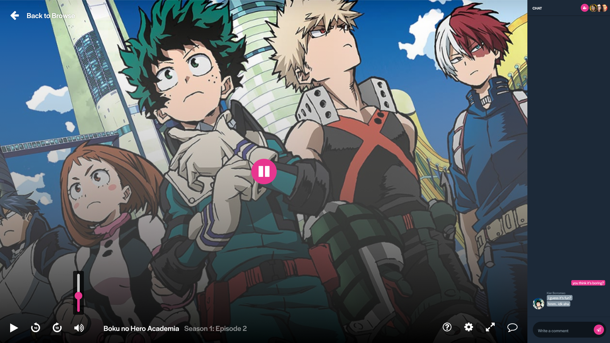

## Care.tv
Care.tv makes it really easy to enjoy movies or watch TV shows with the people you care about, no matter how far!

Works for mobile, tablet, and desktop screens. Does not work with iOS at the moment.

## Quick start

Install Docker with Compose v2 and start its Docker engine. On macOS, the Makefile also uses [Valet](https://laravel.com/docs/valet) and [nvm](https://github.com/nvm-sh/nvm) when available:

```bash
make install   # composer + npm dependencies, and creates missing .env files
make start:db  # start MySQL before running the database setup below
make start     # MySQL + API on http://localhost:8000 + web on http://localhost:1234
```

`make install` runs Composer through `valet composer` and npm through the Node version pinned in `ui/.nvmrc`, falling back to plain `composer`/`node` when Valet or nvm isn't around. It preserves existing `.env` files and stops at dependencies. Fill in the two `.env` files and run the database steps below (`migrate`, `db:seed`, `passport:install`) before using the app; the command prints these steps when it finishes.

Run each service separately with `make start:api`, `make start:db`, or `make start:web`. The original `make start-api` and `make start-ui` commands remain available, along with `make install-api` and `make install-ui`.

`make start` waits for MySQL to be healthy before launching both dev servers. Ctrl-C stops both dev servers. MySQL runs in the background; stop it with `docker compose stop db`. Its data persists in the `mysql-data` Docker volume.

### Local MySQL

Docker Compose runs MySQL 5.7, matching the API's existing database version. The image runs with `linux/amd64` emulation on Apple Silicon. Connect using:

```dotenv
DB_CONNECTION=mysql
DB_HOST=127.0.0.1
DB_PORT=3307
DB_DATABASE=tv
DB_USERNAME=root
DB_PASSWORD=root
```

These values are the defaults in `api/.env.example`. If you already have an `api/.env`, update its `DB_*` values to match. Port `3307` keeps the Docker service separate from MySQL installations using port `3306`.

The rest of this document covers the same setup step by step, plus the bits `make` doesn't automate.

## API Setup
You will need the Docker MySQL service above, [php `>=7.2`](https://thishosting.rocks/install-php-on-ubuntu/) along with [Composer](https://getcomposer.org/), and [ngrok](https://ngrok.com) _(Optional)_

- Move to the `api` folder.
```bash
cd api
```
- Install the dependencies
```bash
composer install
```

- Copy `.env.example` to `.env`, and setup your environment config. Particularly, the database credentials (`DB_*`).
```bash
cp .env.example .env
```

- Open up `.env`, then configure the cdn url & request access code
```bash
# Where your media is stored
APP_CDN=https://your-digital-ocean-cdn.sgp1.cdn.digitaloceanspaces.com/

# This is used for the registration, but you can leave empty.
APP_REQUEST_ACCESS_CODE=
```

- Publish unique key for Laravel.
```bash
php artisan key:generate
```

- Run the migrations. Don't forget to store the client id and secret output from running `php artisan passport:client`.
```bash
php artisan migrate
php artisan db:seed && php artisan db:seed --class=ShowSeeder
php artisan passport:install
php artisan passport:client --password
```

This installs all required tables and creates a user with the following credentials: `admin@admin.com` (email) / `admin` (password)

> Make sure to replace `<YOUR PASSWORD HERE>` with your desired password.

- Setup [Pusher](https://pusher.com/) by logging in to its dashboard, and creating a client. When you're done, open up `.env`, and change the following with the details provided by Pusher:
```bash
PUSHER_APP_ID=
PUSHER_APP_KEY=
PUSHER_APP_SECRET=
PUSHER_APP_CLUSTER=
```

- You should be good to go. Run the command below then head over to `http://localhost:8000`

```bash
php artisan serve
```

### API Setup: Enable Active Presence Locally (Optional)

Active Presence is a feature that lets you know if a user invited to a room is active or not.

If not enabled, users will simply be inactive by default.

- If you're setting this up locally, [setup `ngrok`](https://dashboard.ngrok.com/get-started), then point it to port `8000` (port used by `php artisan serve`).
```bash
ngrok http 8000
```

- Open up Pusher, head over to the _Web Hooks_ tab.

- Either paste the api's public url or ngrok's generated url (e.g., `http://9542199e.ngrok.io`) to the _Webhook URL_ input.

- Select _Presence_ for the _Event Type_, then press _Add_.

## Front-end setup
You will need npm `>=6` and Node.js `>=11`.

- Move to the `ui` folder
```bash
cd ui
```

- Install the dependencies
```bash
npm i
```

- Copy `.env.example` to `.env`, and setup your environment config. Update the `API_CLIENT_*` based on the output from `php artisan passport:client --password` (refer to instructions above).
```bash
cp .env.example .env
```

- Start Parcel, and you're all good.
```bash
npm start
```

It should open up to your a new browser window shortly. However, if it doesn't, you can manually open http://localhost:1234.

You can either register or login with the following credentials: `admin@admin.com` (email) / `admin` (password)

## Deployment
The API and front-end are deployed separately.

### API
Currently, Care.tv is deployed on Laravel Forge. If you follow the API setup instructions properly, things should work out of the box.

- Initially, make sure to setup Laravel Passport:

```bash
php artisan passport:install
php artisan passport:client --password
```

- Make sure to also change the default admin ceredentials as soon as possible:

```bash
php artisan tinker
$user = User::first();
$user->password = Hash::make('<YOUR PASSWORD HERE>');
$user->save();
```

- Lastly, make sure to setup active presence - can also be seen above.

### Front-end
The web interface is hosted on Netlify for free.
- Set the root folder to `ui`; the public folder to `dist`.
- Set the environment config accordingly.
- For the build command:
```bash
npm run build
```

## Custom API Commands
```bash
# Lists the most recent parties since 3 days ago
php artisan app:list-pt
# Lists the most recent parties since 5 days ago
php artisan app:list-pt 5

# Lists the last 15 registrations
php artisan app:list-users
# Lists the last 30 registrations
php artisan app:list-users 30
```

## Attribution
- [DrawKit](https://www.drawkit.io/illustrations/drawing-woman-colour) for the free illustrations pack.
- [Notification Sounds](https://notificationsounds.com/sound-effects) for the notification audio files.
